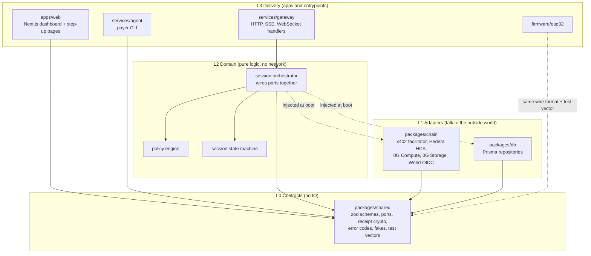

# Technical Architecture and Layer System

System diagrams (sequence, state machine, deployment) are in [`README.md`](../README.md) §1. This file defines the **layers, boundaries, and ports** that let several agents build in parallel without colliding.

## 1. Layers



### Dependency rule (enforced in review)
- A layer imports **only from lower layers**. L0 imports nothing internal.
- L2 never imports L1. It receives adapters as **ports** (interfaces from L0) by injection at boot in `services/gateway/src/main.ts`.
- `apps/web` imports L0 only (types, zod, API client). It never imports gateway code or any key material.
- Firmware shares the **wire format**, not code. The Node test vector is the contract.

## 2. Ports (defined in `packages/shared/src/ports.ts`)

| Port | Methods | Real adapter (L1, `packages/chain`) | Fake (L0) |
|---|---|---|---|
| `PaymentFacilitator` | `requirements(device, minutes)` · `verify(header, req)` · `settle(header, req)` | x402 Hedera client to `X402_FACILITATOR_URL` | `FakeFacilitator` |
| `Decider` | `decide(DecisionInput) → {verdict, reason, requestId}` | `ZeroGDecider` (Router, 4s abort) | `FakeDecider` (configurable ALLOW/DENY/throw/slow) |
| `EpisodeStore` | `put(Episode) → {rootHash}` | 0G Storage | `FakeEpisodeStore` |
| `AuditLog` | `append(AuditEntry) → {seq}` | Hedera HCS topic | `FakeAuditLog` |
| `StepUpProvider` | `start(StepUpRequest) → {authorizeUrl}` · `complete(callback) → StepUpResult` | World OIDC + PKCE | `FakeStepUp` (approve/deny/expire) |
| `Clock` | `now() → unix seconds` | system | `FakeClock` |

Adapters must: apply the timeout from TRD §3.1, throw typed errors from `shared/errors`, never return a made-up success.

## 3. Module map

```
packages/shared/src
  schemas/        zod: session, device, receipt, api, ws messages, episode, audit
  ports.ts        interfaces above
  errors.ts       codes + typed errors
  receipt.ts      canonical encode, sign (Node), verify
  fakes.ts        in-memory fakes for every port
  api-client.ts   typed fetch client for the gateway (used by web and agent)
packages/chain/src
  facilitator.ts  x402 Hedera (server verify/settle + requirements)
  zerog-decider.ts  0G Compute
  zerog-storage.ts  0G Storage
  hcs.ts          Hedera Consensus Service
  world.ts        OIDC discovery, PKCE, token validation
packages/db/
  prisma/schema.prisma   Device, Agent, Session, SessionEvent, StepUp, UsedNonce
  src/repos.ts    typed repositories
services/gateway/src
  config.ts       zod env parse, fail fast
  core/policy.ts  pure function
  core/session-machine.ts  allowed transitions only
  core/orchestrator.ts     verify → policy → stepup → decide → receipt → push → ack → settle → log
  http/           Hono routes (session, stepup, devices, agents, audit, health)
  ws/devices.ts   device hub
  sse.ts          event stream
  main.ts         composition root (injects real adapters or fakes by env)
services/agent/src
  pay.ts          payer using @x402/fetch + Hedera signer
  cli.ts          rent, status
apps/web/src
  app/            pages (devices, sessions, agents, audit, step-up, api/world/callback)
  lib/            gateway client wrapper, SSE hook
firmware/esp32/src
  main.cpp  net.cpp  verify.cpp  relay.cpp  timer.cpp  config.h  secrets.h(ignored)
```

## 4. Parallel lanes and ownership

| Lane | Owns (only edits here) | Depends on | Can run before others land? |
|---|---|---|---|
| **A. web** | `apps/web/**` | L0 types, API.md | Yes: runs against a fixture gateway from `shared/fakes` + mock server |
| **B. backend** | `services/gateway/**`, `services/agent/**`, `packages/db/**` | L0 ports and fakes | Yes: composition root injects fakes |
| **C. web3** | `packages/chain/**` | L0 ports, errors | Yes: each adapter is tested alone against its sandbox |
| **D. firmware** | `firmware/esp32/**` | `shared/test-vectors/receipt.json`, API.md §WS | Yes: serial test script feeds the vector |
| **Core (lead)** | `packages/shared/**`, `docs/**`, root config | — | Lands **first** (PR3); lanes branch from it |

`packages/shared` is the only shared write surface. Changes follow the contract-change protocol in `docs/WORKFLOW.md` §5.

## 5. Integration points (where lanes meet)

| Seam | Producer | Consumer | Contract |
|---|---|---|---|
| Receipt bytes | shared (Node sign) | firmware (verify) | `docs/API.md` §3 + `test-vectors/receipt.json` |
| Device WS messages | gateway (B) | firmware (D) | `docs/API.md` §2 |
| REST + SSE | gateway (B) | web (A), agent (B) | `docs/API.md` §1, `shared/schemas/api` |
| Ports | chain (C) | gateway (B) | `shared/ports.ts` |
| Env/config | root `.env.example` | all | `docs/TRD.md` §5 |

## 6. Composition root

`services/gateway/src/main.ts` reads env `ADAPTERS=fake|real` (default `fake` until the web3 lane lands each adapter; individual overrides like `DECIDER=real` allowed). This is what lets backend, web, and firmware progress while web3 integrations are still in flight, and it gives the demo a clean fallback (simulation mode counts for 0G if hardware fails).

## 7. Session flow ownership (one function owns it)

`core/orchestrator.ts` is the only place the order of operations lives. Everything else (policy, state machine, adapters) is a leaf it calls. Changing the order requires an ADR in `docs/DECISIONS.md`.
